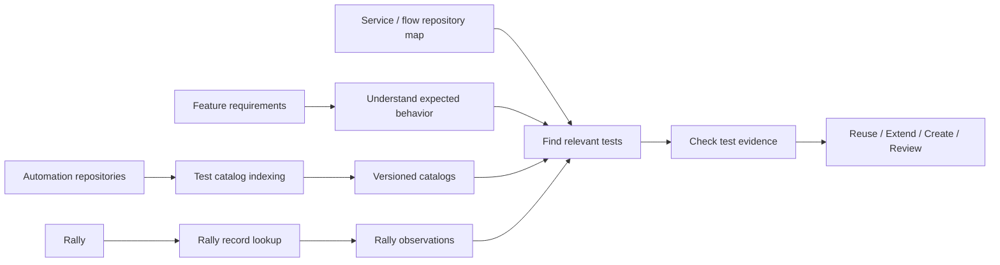

# QA Test Catalog — A Method for Reusing Existing Automation Tests

## The problem

Automation tests are spread across backend, frontend and shared end-to-end (E2E) repositories. Some repositories contain more than 1,000 test cases (TCs). When a feature changes, QA must work out which existing tests cover the affected behavior before writing more tests.

That is difficult when tests belong to different teams, test names do not describe the full flow, and requirements come from different document formats. Every automated TC also links to Rally, but a Rally record might be unavailable or its last recorded result might be old.

The problem is **finding and verifying existing coverage**, not generating tests faster.

## The method

Maintain a searchable catalog for each automation repository and use it to check existing tests before deciding whether to create new ones.

The method combines two ongoing activities—**catalog maintenance** and **Rally data refresh**—with a QA review that runs for each feature.

**The catalog is searched outside the LLM.** The model receives only relevant test candidates and the source evidence needed to assess them. Routine indexing and initial search do not need model calls.

## How a feature is reviewed

1. Identify the behavior, conditions and expected results from the specification.
2. Determine which service, frontend and shared E2E repositories may contain relevant tests.
3. Search their catalogs and inspect the most relevant existing tests.
4. Check actual setup, assertions and test purpose against the requirements.
5. Recommend **REUSE**, **EXTEND**, **CREATE** or **REVIEW** and record the supporting evidence.

A missing search result is not proof that a test does not exist. The decision also depends on repository coverage, catalog freshness and access to the source code.

## Where Rally fits

Rally helps link automation tests to managed TCs and shows their last recorded results. This is useful for traceability, but it must be interpreted carefully:

- A linked TC that cannot be found might be deleted, moved or inaccessible.
- A recorded Pass or Fail in Rally is **not the outcome of the current CI run**.
- The Rally lookup time and the recorded result time are different.
- Neither Rally status nor test-name similarity proves requirement coverage.

## Architecture choices

The catalogs remain with their automation repositories, stored on a separate `qa-catalog` branch rather than committed to `main`. GitHub Actions can update a catalog when source reaches `main`; Rally observations refresh separately because Rally changes independently of code.

An agent uses GitHub CLI (`gh`) and a local search capability to read catalogs without checking out each catalog branch or running an MCP server. The design keeps repository access controls and Rally visibility separate.

## Documents

| Document | Purpose |
| --- | --- |
| [01 — Problem and goals](docs/01-problem-and-goals.md) | What makes existing-test discovery difficult and what the method must solve |
| [02 — Resolution method](docs/02-resolution-method.md) | How catalog maintenance and per-feature QA review work |
| [03 — Architecture](docs/03-reference-architecture.md) | Components, information flow and trust boundaries |
| [04 — Design choices](docs/04-decisions-and-tradeoffs.md) | Reasons for the main choices and their limits |
| [05 — Quality and validation](docs/05-quality-and-validation.md) | How to judge whether the method works |

This repository describes the method and system architecture. It does not define implementation code, CLI commands, CI workflow files or API schemas.
