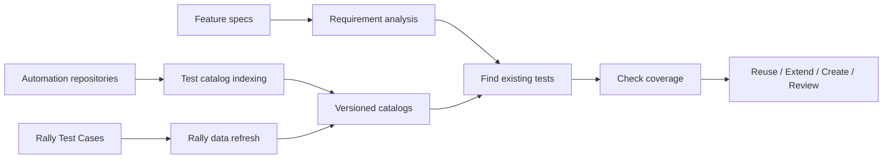

# QA Test Catalog — Solution Architecture

**Status:** Proposed

**Scope:** Problem, proposed solution, system architecture and key decisions

**Audience:** QA leads, automation engineers, software architects and DevOps teams

## Overview

Our automation tests are spread across backend, frontend and shared end-to-end (E2E) repositories. A single repository may contain more than 1,000 test cases (TCs). When a team delivers a new feature or modernizes an existing one, QA has to find relevant tests across these repositories before deciding what to add or change.

Today, that search takes time and is difficult to reproduce. Test names do not always describe the behavior they check, and shared E2E tests may cover several services without naming them. Feature specifications also vary between SpecKit and custom software design documents (SDD). Every automated TC is linked to Rally, but the Rally record may be unavailable or its last recorded result may be outdated.

The goal is to make existing tests easier to find and assess **without passing entire test repositories or catalogs to an LLM**.

## Proposed approach

Maintain a small, searchable catalog for each automation repository. Indexing collects test identities, locations and other useful information from source code without using an LLM. The catalog is updated when the repository changes.

A separate process checks the linked Rally TCs and retrieves their latest recorded results. Rally data is refreshed independently because a TC or its result can change without any source-code change.

When QA reviews a feature, the workflow:

1. Reads the requirements, regardless of the original spec format.
2. Identifies affected services and business flows.
3. Searches the relevant service and shared E2E catalogs.
4. Checks source-level evidence for the most relevant existing tests.
5. Recommends **REUSE**, **EXTEND**, **CREATE** or **REVIEW**, with reasons.

The agent can access catalogs through GitHub CLI (`gh`) and search them locally. It does not need to check out the catalog branch or use an MCP server. Only a short list of candidate tests and the source details needed for review are passed to the LLM.

## Architecture at a glance

## Design documents

| Document | What it covers |
| --- | --- |
| [01 — Problem and goals](docs/01-problem-and-goals.md) | Current QA issues and expected improvements |
| [02 — Proposed solution](docs/02-proposed-solution.md) | How catalog indexing, Rally and QA review work together |
| [03 — System architecture](docs/03-reference-architecture.md) | Main components, data flows and system boundaries |
| [04 — Design decisions](docs/04-decisions-and-tradeoffs.md) | Alternatives, trade-offs and unresolved constraints |
| [05 — Validation and next steps](docs/05-success-criteria-and-roadmap.md) | How to test the approach before broader adoption |

## Important distinctions

- A catalog entry shows that an automation test exists. It does **not** prove that the test covers a particular requirement.
- A missing Rally TC may have been deleted, moved or hidden by access restrictions. The automation test should not be removed based on a failed lookup.
- The last test result stored in Rally is historical information, **not the result of the current CI run**.
- If search finds no matching test, QA still needs to consider search scope and catalog completeness before deciding to create one.

This repository describes the solution, not its implementation. It contains no workflow YAML, executable tools, detailed schemas or mock API responses.
