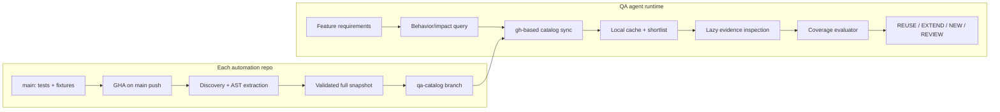

# QA Catalog Indexing Architecture

**Status:** Proposed architecture (documentation only)  
**Repository:** ghostlives/qa-catalog-indexing-architecture  
**Scope:** Deterministic indexing of automation test cases from many independently owned repositories.  
**Implementation:** None. No executable indexer, GitHub Actions workflow, MCP server, or production integration is included.

## Problem statement

An enterprise SDLC can contain dozens or hundreds of backend, frontend, and shared E2E automation repositories. Individual repositories may contain more than 1,000 test cases. New features and modernization work require QA teams to identify existing tests **before** authoring new ones. Requirement documents can originate from SpecKit or custom SDD processes.

A monolithic test catalog provided to an LLM on every request is too expensive and unreliable. This design stores *structured, versioned test signals outside the LLM context*, then retrieves only relevant candidates for evidence-based coverage evaluation.

## Architectural decisions

| Concern | Proposed choice | Why |
| --- | --- | --- |
| Indexing trigger | Push to the source repository's default main branch after merge | Automation and consistent provenance |
| Indexing engine | Framework-native test discovery + AST/static extraction | No LLM cost during indexing |
| Initial indexing mode | Deterministic full snapshot per repo | Correct handling of additions, updates, removals |
| Catalog format | JSONL test records + JSON manifest | Portable, streamable, schema-versioned |
| Rally traceability | Rally TC references in static records + independently refreshed enrichment overlay | Handles deleted/inaccessible TC links and historical results without source reindex |
| Catalog storage | Separate **qa-catalog** branch in the same repository | Git history without generated commits on main |
| Version identity | Exact source commit SHA | Makes freshness and auditability explicit |
| Runtime access | GitHub CLI (gh) + GitHub API, not MCP | Fits local coding agents and enterprise workflows |
| Runtime search | Local cache + lexical/metadata search initially | No large catalog sent to LLM |
| Semantic verification | On-demand LLM over shortlisted source/evidence only | Reuse-first, controlled token use |
| Multi-repo growth | Optional aggregated search index, not mandatory for PoC | Incremental adoption |

## Documentation map

1. [Problem, scope and requirements](docs/01-requirements.md)
2. [System architecture and data flow](docs/02-architecture.md)
3. [GHA indexing pipeline and framework adapters](docs/03-indexing-pipeline.md)
4. [Catalog data contract and test identity](docs/04-data-contract.md)
5. [Branch storage, publication and consistency](docs/05-storage-publication.md)
6. [Runtime retrieval via gh CLI](docs/06-retrieval-gh-cli.md)
7. [Quality, security, performance and token controls](docs/07-quality-security-cost.md)
8. [PoC roadmap and acceptance tests](docs/08-poc-rollout.md)
9. [Failure modes and recovery](docs/09-failure-modes.md)
10. [Open design questions](docs/10-open-questions.md)
11. [Rally linkage, validity and last recorded result enrichment](docs/11-rally-enrichment.md)

### Architecture decision records
- [ADR-0001: Deterministic indexing](docs/adr/0001-deterministic-indexing.md)
- [ADR-0002: Catalog on separate branch](docs/adr/0002-catalog-branch.md)
- [ADR-0003: gh CLI, not MCP](docs/adr/0003-gh-cli-access.md)
- [ADR-0004: Reuse-first with lazy evidence](docs/adr/0004-reuse-first-retrieval.md)
- [ADR-0005: Independent Rally enrichment and freshness](docs/adr/0005-rally-enrichment-decoupled.md)

### Mock data (illustrative, non-executable)
- [Snapshot manifest](mock-data/manifest.json)
- [Test records](mock-data/tests.jsonl)
- [Search results](mock-data/search-results.json)
- [Coverage evaluation](mock-data/coverage-evaluation.json)
- [Rally enrichment manifest](mock-data/rally-manifest.json)
- [Rally enrichment records](mock-data/rally-enrichment.jsonl)

## End-to-end operating model

## Rally enrichment (independent of main merges)

Every automation TC is expected to link to a Rally Test Case. The static index records that link, while a separate read-only Rally WSAPI refresh resolves existence and last **recorded** result into `rally-enrichment.jsonl` and `rally-manifest.json` on the catalog branch. Results are historical Rally observations, **not** current CI/runtime statuses. A missing Rally item might be deleted, inaccessible or moved; disappearance does not automatically invalidate automation tests. See [Rally enrichment design](docs/11-rally-enrichment.md).

## Explicit non-goals

- No new production application or service.
- No auto-generated test cases as part of indexing.
- No production source code modification.
- No automatic assertion of business coverage from test names, similarity scores, or static signals alone.
- No database, vector store, embedding job, or MCP dependency for the first PoC.
- No bypass of branch protection or repository access permissions.

## Guiding principles

1. **Catalog is data, not prompt context.** Large snapshots are never passed to an LLM.
2. **Discovery is not coverage.** Indexer records observed tests and evidence; QA evaluator establishes coverage separately.
3. **Fail closed on uncertainty.** Incomplete discovery or missing repository access means UNKNOWN, never confidently MISSING.
4. **Provenance is mandatory.** Each record points to a repo, commit, file, and test identity.
5. **Publication is monotonic.** A snapshot from an older main commit must not replace a newer snapshot.
6. **One logical test may have many execution variants.** Parameterized cases, browser projects, and environments are modeled separately.
7. **Indexing is recoverable.** Keep the previous valid snapshot when CI fails.

## Intended outcome

A QA agent can search historical automation tests across repositories without cloning every catalog branch, loading every test into context, or creating duplicate tests by default. A shortlist is verified with source-level evidence, then routed to REUSE, EXTEND, NEW, or REVIEW.

**This repository is a design baseline, not a claim that a working indexer or search tool exists.**
