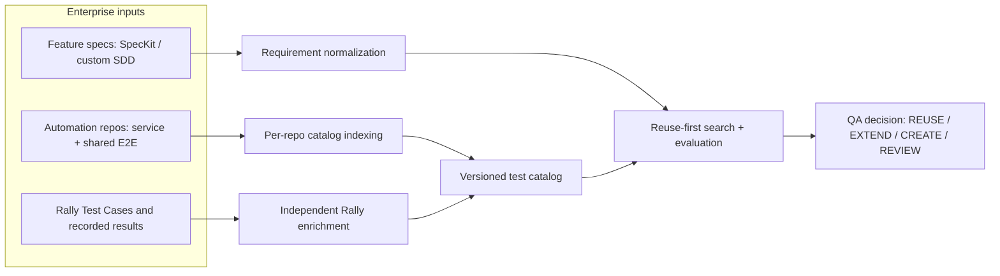

# QA Test Catalog Intelligence — Solution Architecture

> **Status:** Architecture proposal · **Audience:** QA architects, engineering leads, automation owners and platform teams · **Scope:** Problem, solution, architecture and trade-offs.
> **No implementation code or deployment instructions are included.**

## Executive summary

In a multi-repository SDLC, automation test cases are dispersed across service-level and shared E2E repositories. New feature or modernization work often creates redundant tests because existing coverage is difficult to discover and verify. The difficulty increases when different teams use different specification frameworks and when Rally Test Case references are stale or inconsistent.

**Proposed solution:** Establish a **Reuse-First QA Test Intelligence capability** that maintains a lightweight, searchable catalog of automation tests, enriches it with independently observed Rally information, and supports evidence-based decisions to **REUSE, EXTEND, CREATE, or REVIEW**—before any new test generation.

The central architectural principle is:

**Catalog and search stay outside the LLM context. The LLM only evaluates shortlisted, source-backed evidence.**

## Problem → Solution at a glance

| Enterprise challenge | Architectural response |
| --- | --- |
| Backend, frontend and E2E tests distributed across many repositories | Federated, per-repository test catalog |
| 1,000+ test cases in a single automation repo | Deterministic indexing and selective retrieval |
| Existing tests difficult to identify for a new feature | Reuse-first discovery and evidence-based coverage evaluation |
| SpecKit and custom SDD documents vary in structure | Framework-independent requirement normalization |
| Rally links may be missing, deleted or inaccessible | Rally reference resolution with explicit uncertainty |
| Rally last recorded result is not the current CI outcome | Distinct lifecycle and freshness for Rally observations |
| Many test records would consume excessive model tokens | Search locally through `gh`-based access and send only top candidates to the model |

## Solution at a glance

## Read the proposal

1. [Problem and desired outcomes](docs/01-problem-and-goals.md)
2. [Proposed solution](docs/02-proposed-solution.md)
3. [Reference architecture](docs/03-reference-architecture.md)
4. [Architectural decisions and trade-offs](docs/04-decisions-and-tradeoffs.md)
5. [Success criteria, scope and evolution](docs/05-success-criteria-and-roadmap.md)

## Key boundaries

- **Source code** defines the automation test implementation. The catalog is derived metadata, not a second source of truth.
- **Rally** is an independent test-management system; a missing Rally TC does not automatically invalidate an automation test.
- **Rally's last recorded result** is historical metadata, not the current runtime automation status.
- **Search relevance** does not prove coverage. A coverage decision needs relevant assertions, setup and/or execution evidence.
- **No result found** does not mean no test exists, especially when repository scope or indexing completeness is uncertain.

## Proposed operating model

Automation repositories produce versioned catalogs when their main branches change, using an existing CI capability such as GitHub Actions. Rally information is refreshed independently because its Test Cases and recorded results can change without code merges. A QA agent accesses selected catalogs through a small **GitHub CLI–based retrieval capability**, without needing MCP or checkout of every catalog branch. Detailed test evidence is inspected only as needed.

This repository intentionally describes the **what and why**, not the **how-to-build**. Detailed schemas, workflow definitions, framework-specific parsers, command examples and mock implementation data are deferred to a future engineering design.
