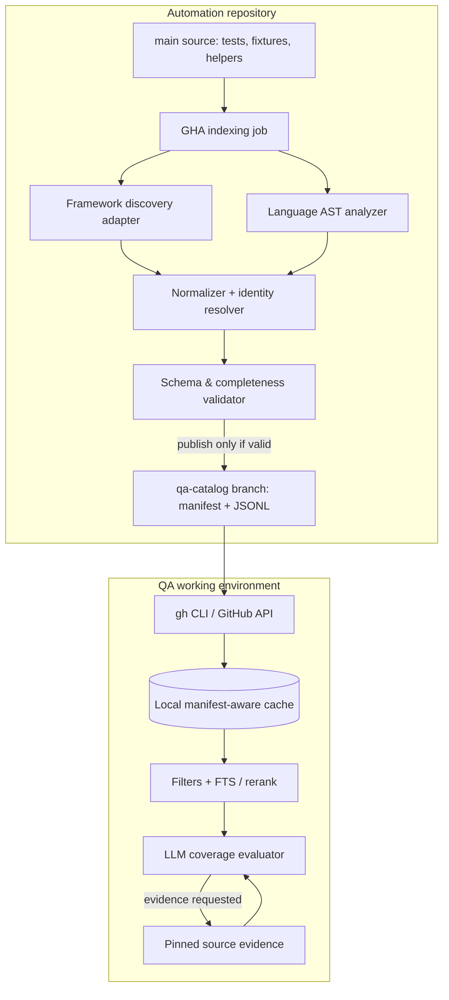
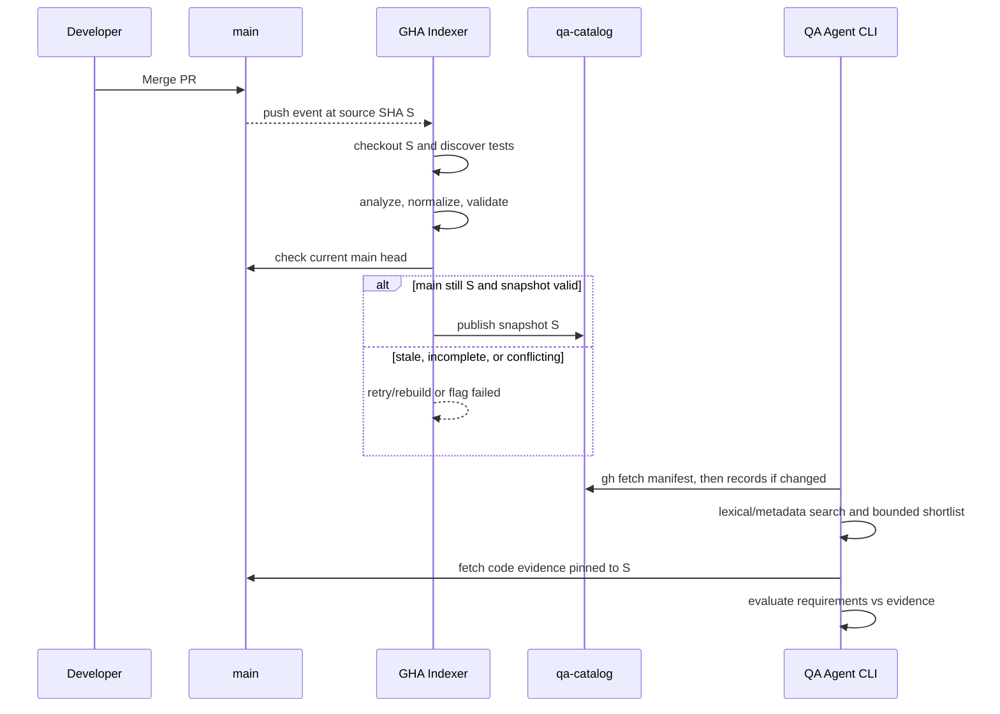

# 02 — Architecture and Component Boundaries

## Architectural position

The architecture separates **index-time** extraction from **query-time** reasoning. Each repository owns its snapshot. The QA agent consumes a compact view through a local deterministic search utility that can use gh CLI as the transport.

## Separation of responsibilities

| Component | Input | Output | LLM? |
| --- | --- | --- | --- |
| Main-branch event | Repository SHA | Indexing invocation | No |
| Framework adapter | Configured automation project | Discovered suites, tests, variants | No |
| AST analyzer | Test source and optionally known helpers | Syntactic signals + evidence locations | No |
| Normalizer | Discovery + AST results | Canonical records and diagnostics | No |
| Validator | Full snapshot | Validated snapshot or structured failure | No |
| Publisher | Validated snapshot, source SHA | qa-catalog commit, manifest | No |
| gh catalog transport | Repository, catalog branch, snapshot version | Bytes and metadata | No |
| Local search cache | Catalog records | Ranked candidate IDs | No |
| Evidence fetch | Candidate ID and pinned source SHA | Source ranges, fixtures, assertions | No |
| Coverage evaluator | Requirement obligations and selected evidence | REUSE / EXTEND / NEW / REVIEW | Yes, on demand |
| Rally enrichment | Deduplicated TC links + read-only Rally observations | Case resolution, historical last-result overlay | No |

## Rally enrichment extension

The deterministic catalog records Rally TC references but does not require Rally to be available during source indexing. A separate read-only Rally enrichment job resolves references and stores `rally-manifest.json` + `rally-enrichment.jsonl` with `rally_fetched_at`, source-catalog revision and workspace context. This independent overlay supports result changes even when no code is merged. A missing case is not automatically classified as deleted (permission, workspace, and scope changes must be ruled out). Historical Rally verdict and current CI/runtime execution status are separate facts. See [Rally enrichment](11-rally-enrichment.md).

## Data ownership

- Source code is authoritative for test implementation.
- Framework discovery is authoritative for tests it can enumerate at a known configuration; completeness must be reported rather than assumed.
- AST signals are machine-observed but **not** assertions of business coverage.
- The catalog is a *derived versioned artifact*.
- QA coverage evaluations are separate, historically revisable claims linked back to catalog records.

## Standard source-to-catalog lifecycle

## Why not load the catalog into an LLM?

A hypothetical 50 repositories x 1,000 tests x 200 tokens per record produces 10 million tokens of metadata before test bodies. Indexing and retrieval do not require a model to read all that text. Search returns candidate identifiers and narrowly selected signals; the LLM sees only shortlisted evidence.

## E2E and cross-service relationships

The source-level index may record explicit API paths, client calls, tags, helper references, page objects, and service hints. Unresolved service relations remain UNKNOWN. A future enrichment pass can build a graph from API contracts and traces, but should not be mandatory for the initial index.

## Contract boundaries

The snapshot schema, not the branch name or search implementation, is the integration contract. This enables future migration from Git branch storage or local SQLite without changing downstream QA decision semantics.

## Compatibility with heterogeneous specification frameworks

This repository deliberately does not design full SpecKit/SDD adapters. The QA query input is assumed to contain normalized, atomic verification obligations with source references. All retrieval and evaluation operate on obligations rather than raw spec document templates.
