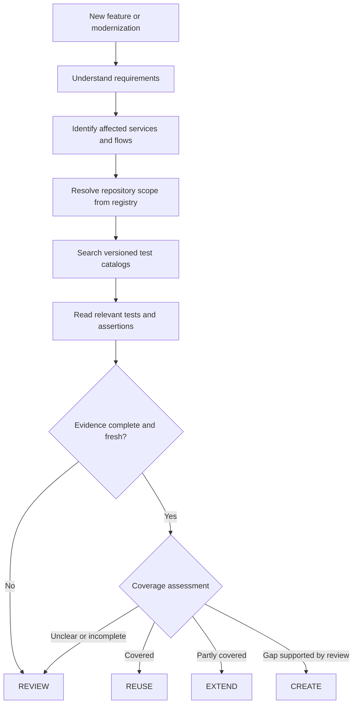

# 02 — Proposed Solution

## Summary

Use a catalog for each automation repository and search those catalogs before creating test cases. The catalog gives QA a way to locate existing tests; it does not try to describe every business behavior in full.

The solution has seven parts: **repository scope registry, test catalog indexing, catalog publication, Rally data refresh, requirement analysis, existing-test review, and reproducible decision evidence**.

## 1. Resolve the repositories that must be searched

A small, version-controlled repository registry maps:

- Stable repository identifiers and GitHub coordinates.
- Repository type and supported test framework adapters.
- Owned services, user journeys and business-domain aliases.
- Default branch, owners and catalog location.
- Related service, frontend and shared E2E repositories.

Requirement analysis uses this registry to produce an explicit search set. QA can add repositories, but the final evidence record must show both the registry-derived scope and any manual changes. An empty search is not actionable when the registry is missing, stale or does not cover the affected domain.

## 2. Build a catalog from automation source

When a repository changes, an indexing process identifies the tests it contains and records useful information such as test identity, source location, tags and available assertion or API signals.

Framework test discovery and source analysis provide this information without asking an LLM to read every test. A catalog stays linked to the source version it describes, so readers can tell whether it is current.

The catalog is stored separately from source code changes. The initial proposal uses a `qa-catalog` branch in each repository rather than adding generated files to `main`.

**Limit:** source analysis can identify code patterns, but it cannot always determine the business meaning of a test—particularly when fixtures, helpers, mocks or page objects hide the details.

Framework support is adapter-based. Each adapter declares which framework versions, discovery modes and fields it supports. Static parsing is preferred. If accurate discovery requires importing or executing repository code, it runs in a disposable environment with no production credentials, no write token, restricted network access and resource limits.

## 3. Publish an internally consistent catalog

The `qa-catalog` branch contains immutable source snapshots and a small current manifest. A logical layout is:

```text
manifest.json                           -> current source snapshot and compatible Rally observation
source-snapshots/<source-sha>/          -> immutable, deterministic index output
rally-observations/<refresh-id>/        -> immutable, time-bounded lookup results
```

A single publisher, or a publisher using compare-and-swap against the branch head, advances the manifest only after validating the complete snapshot. Late jobs cannot move the manifest back to an older source revision. Re-running the same input produces the same source snapshot.

The implementation may shard or compress the physical files, but readers must be able to resolve one consistent manifest. Retention and branch compaction are required so generated history does not grow without limit.

## 4. Add Rally information without rescanning source

Each automation test is expected to have a Rally TC reference. The source index records that link. Rally is then queried separately to check whether the linked case can be found and, when available, to read its last recorded result.

These are distinct pieces of information:

| Information | How QA should use it |
| --- | --- |
| Source test exists | Confirms that a test definition is present at the indexed version |
| Rally TC can be found | Confirms that the linked record was accessible during the last check |
| Rally TC cannot be found | Indicates a link to investigate; deletion is not yet confirmed |
| Last result stored in Rally | Provides historical context with a recorded date |
| Current CI test result | Describes the outcome of an actual automation run, if separately available |

Rally data may change between source merges. Its refresh schedule and freshness therefore need to be independent of catalog indexing. Any Rally metadata stored alongside a repository catalog must comply with Rally access restrictions.

Rally observations are joined to the exact test identities in a source snapshot. A refresh must not silently attach an observation to a renamed or deleted test. Lookup outcomes distinguish at least `FOUND`, `NOT_FOUND`, `FORBIDDEN_OR_HIDDEN`, `NO_RESULT`, `AMBIGUOUS`, `RATE_LIMITED`, `ERROR` and, only when the API provides authoritative evidence, `DELETED`.

“Latest result” requires an organization-approved selection rule: the Rally record relationship to follow, allowed workspace/project, execution type or environment, ordering timestamp, timezone and tie-break behavior. The observation retains the selected result identity and recorded time. If the API returns competing results that the rule cannot resolve, the status is `AMBIGUOUS` rather than an arbitrary verdict.

Before any Rally field is copied to GitHub, the security owner must confirm that every catalog reader is authorized to see it. If GitHub readership is broader, Rally observations stay in an access-controlled store or are fetched at review time; the catalog contains only the Rally reference already present in source.

## 5. Read requirements consistently

A feature can start from SpecKit, a custom SDD or another specification. QA analysis should extract the same basic information regardless of format:

- What behavior is being changed?
- Under what conditions should it happen?
- What outcomes should be verified?
- Which services or end-to-end journeys might be affected?
- What is missing or unclear?

The original requirement reference is retained so QA can check the interpretation. If a rule is ambiguous, the workflow should ask for review rather than inventing a business requirement.

Requirement content is treated as untrusted data. Embedded instructions cannot alter agent policy, expand repository access or cause tool execution. Each normalized scenario keeps a stable requirement identifier, source version, conditions, expected outcomes and unresolved questions.

## 6. Search first, then check actual coverage

The agent searches catalogs from the services and E2E repositories likely to be affected. Metadata and text search reduce the candidates before the model reads test bodies or related source code.

For shortlisted tests, QA evaluates the setup, assertions and scope against the requirement. This leads to one of four recommendations:

| Decision | When to use it |
| --- | --- |
| **REUSE** | An existing test adequately checks the intended behavior at the required test level |
| **EXTEND** | A related test exists but needs another condition or assertion |
| **CREATE** | The relevant search and review support a genuine coverage gap |
| **REVIEW** | The requirement, test behavior or search scope is still uncertain |

A test in an API suite and one in an E2E suite are not necessarily duplicates, even when they check a similar rule. They may protect different failure points.

Search starts with deterministic filters and lexical ranking across names, tags, source paths, Rally references, extracted API/UI signals and domain aliases. Semantic retrieval can be evaluated later, but it must not replace exact identifier and metadata matches. Candidate ranking exposes the matched fields and does not ask the model to score the whole catalog.

When results are weak, the workflow expands aliases, related repositories and source evidence within configured limits. A no-match result must include the repositories searched, catalog status and revision, query terms, unsupported adapters and exclusions. If any required scope is stale, partial, failed or inaccessible, the default decision is **REVIEW**, not **CREATE**.

## 7. Produce a reproducible QA evidence record

Every recommendation records:

- Requirement identifiers and source version.
- Registry version and repositories searched or excluded.
- Catalog manifest, source commit and freshness state per repository.
- Query terms, filters and candidate-ranking reasons.
- Test source locations and the setup/assertions inspected.
- Rally lookup status, observation time and result-recorded time, when authorized.
- Decision, confidence, unresolved questions and QA approver.

The evidence record contains references and short excerpts rather than whole repositories. It supports human review and later evaluation without claiming that a model-generated interpretation is ground truth.

## QA workflow



## Role of the Evaluator–Optimizer loop

The evaluator checks whether the proposed QA plan is supported by the requirements and existing tests. If something is missing, the workflow can refine the search, inspect another test or revise the proposed plan.

The loop must have limits. Repeatedly asking a model to review the same information will not resolve a missing spec, inaccessible repository or unclear assertion. Those cases need human input.

The loop also has a fixed candidate and iteration budget. It stops on sufficient evidence, no material change between iterations, a configured cost limit, or an incomplete-evidence condition. It never gains additional permissions merely because evidence is missing.

## What this approach should improve

QA spends less time locating tests across repositories. Test plans can point to existing source and Rally references. The model receives a small set of relevant tests rather than the full catalog, while QA retains control over uncertain coverage decisions.
