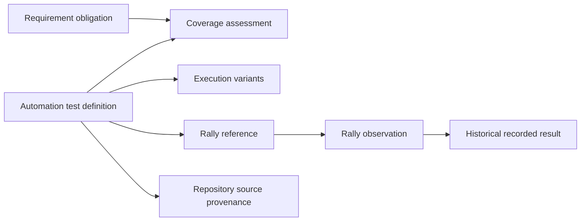
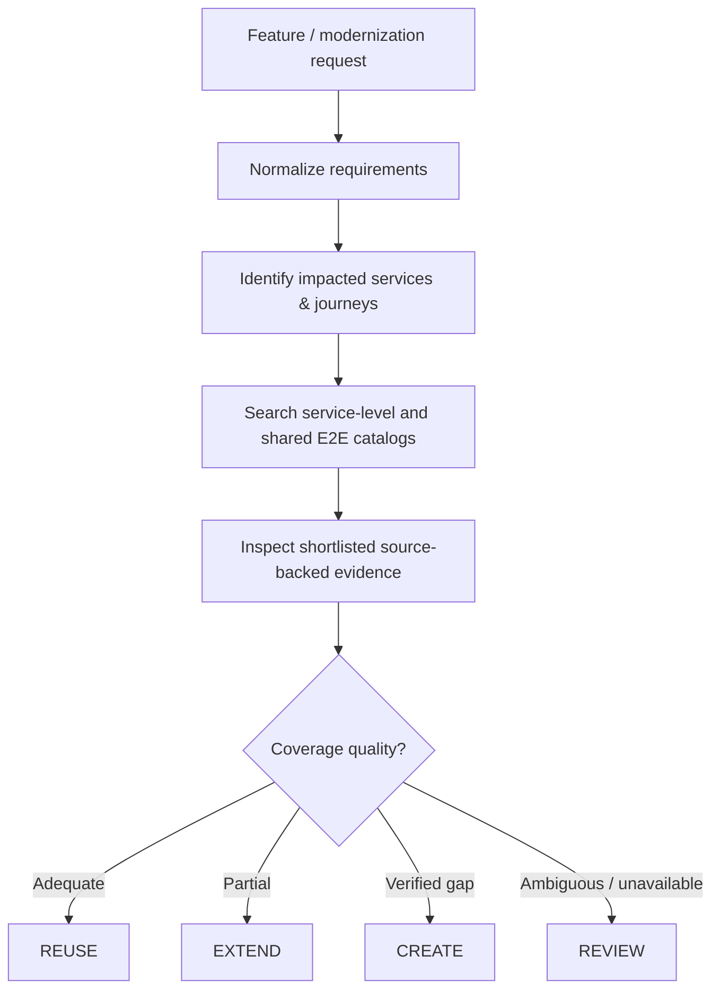

# 02 — Proposed Solution

## Solution concept: Reuse-First QA Test Intelligence

Create a **federated test catalog** that provides an efficient entry point to test discovery without collecting entire repositories in an LLM prompt.

The system consists of four complementary capabilities:

| Capability | Responsibility | Primary outcome |
| --- | --- | --- |
| **Catalog Indexing** | Discover tests in each automation repository and retain source-backed metadata | Known test inventory with provenance |
| **Rally Enrichment** | Resolve linked Rally records and observe their last recorded results | Traceability, validity uncertainty and historical context |
| **Requirement Interpretation** | Normalize feature specs into QA-verifiable obligations | A consistent QA analysis input |
| **Reuse-First Evaluation** | Find relevant tests, inspect evidence and decide whether to reuse, extend or create | Justified QA plan with minimal duplication |

## Architectural principles

**1. Separate indexing from reasoning.** Test discovery and metadata generation are deterministic; LLM evaluation is reserved for ambiguous semantic coverage questions.

**2. Reuse before creation.** Generation is conditional on review of relevant existing test evidence—not the first step.

**3. Preserve source ownership.** Each automation repository remains authoritative for its tests and publishes a derived, versioned catalog.

**4. Keep independent freshness dimensions.** Source code and Rally data evolve separately. A catalog revision is not evidence that Rally's stored result is current.

**5. Search first, inspect progressively.** Metadata narrows the search; source and assertion details are loaded only for shortlisted candidates.

**6. Surface uncertainty.** Incomplete retrieval, permissions, and ambiguous requirements lead to REVIEW/UNKNOWN rather than confident but unsupported decisions.

**7. Minimize operational friction.** Leverage existing GitHub Actions and GitHub CLI; a dedicated MCP server or centralized vector database is not required for an initial solution.

## Conceptual data model

The diagram is **conceptual**: it does not prescribe database tables or API contracts.

- **Automation test:** A logical test definition in code.
- **Execution variant:** One possible runnable configuration or parameterization.
- **Rally reference:** Link from automation to test-management identity, which may have a many-to-one relationship.
- **Rally observation:** A timestamped view of whether the linked TC could be resolved and what Rally last recorded.
- **Requirement obligation:** An independently verifiable expected behavior extracted from a feature.
- **Coverage assessment:** A reasoned relationship between an obligation and available test evidence.

## The Rally distinction

Three independent questions must be answered:

| Question | Authoritative context | Interpretation |
| --- | --- | --- |
| Does the automation test exist? | Source repository and test discovery | Source inventory |
| Does the linked Rally Test Case exist and remain accessible? | Rally under an authorized workspace/project | Resolved, uncertain, inaccessible or confirmed deleted |
| What was Rally's last recorded result? | Rally result record or documented aggregate field | Historical observation, not a current runtime result |

A Rally TC may be **unavailable** because it was deleted, moved, or is outside the caller's permissions. A failed lookup alone is not proof of deletion. Even a confirmed deleted Rally case is a traceability issue and does not prove the automation code is invalid.

## End-to-end QA decision flow

Rally metadata supports retrieval and triage; it never substitutes for evidence that the behavior is actually asserted.

## Expected benefits

Lower duplicated test creation, improved discovery across service and E2E repositories, more predictable context cost, clearer QA traceability, and explicit visibility into broken or inaccessible Rally mappings.
