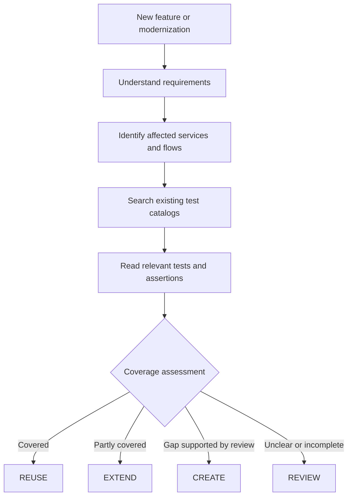

# 02 — Proposed Solution

## Summary

Use a catalog for each automation repository and search those catalogs before creating test cases. The catalog gives QA a way to locate existing tests; it does not try to describe every business behavior in full.

The solution has four parts: **test catalog indexing, Rally data refresh, requirement analysis, and existing-test review**.

## 1. Build a catalog from automation source

When a repository changes, an indexing process identifies the tests it contains and records useful information such as test identity, source location, tags and available assertion or API signals.

Framework test discovery and source analysis provide this information without asking an LLM to read every test. A catalog stays linked to the source version it describes, so readers can tell whether it is current.

The catalog is stored separately from source code changes. The initial proposal uses a `qa-catalog` branch in each repository rather than adding generated files to `main`.

**Limit:** source analysis can identify code patterns, but it cannot always determine the business meaning of a test—particularly when fixtures, helpers, mocks or page objects hide the details.

## 2. Add Rally information without rescanning source

Each automation test is expected to have a Rally TC reference. The source index records that link. Rally is then queried separately to check whether the linked case can be found and, when available, to read its last recorded result.

These are distinct pieces of information:

| Information | How QA should use it |
| --- | --- |
| Source test exists | Confirms that a test definition is present at the indexed version |
| Rally TC can be found | Confirms that the linked record was accessible during the last check |
| Rally TC cannot be found | Indicates a link to investigate; deletion is not yet confirmed |
| Last result stored in Rally | Provides historical context with a recorded date |
| Current CI test result | Describes the outcome of an actual automation run, if separately available |

Rally data may change between source merges. Its refresh schedule and freshness therefore need to be independent of catalog indexing. Any Rally metadata stored alongside a repository catalog must comply with Rally access restrictions.

## 3. Read requirements consistently

A feature can start from SpecKit, a custom SDD or another specification. QA analysis should extract the same basic information regardless of format:

- What behavior is being changed?
- Under what conditions should it happen?
- What outcomes should be verified?
- Which services or end-to-end journeys might be affected?
- What is missing or unclear?

The original requirement reference is retained so QA can check the interpretation. If a rule is ambiguous, the workflow should ask for review rather than inventing a business requirement.

## 4. Search first, then check actual coverage

The agent searches catalogs from the services and E2E repositories likely to be affected. Metadata and text search reduce the candidates before the model reads test bodies or related source code.

For shortlisted tests, QA evaluates the setup, assertions and scope against the requirement. This leads to one of four recommendations:

| Decision | When to use it |
| --- | --- |
| **REUSE** | An existing test adequately checks the intended behavior at the required test level |
| **EXTEND** | A related test exists but needs another condition or assertion |
| **CREATE** | The relevant search and review support a genuine coverage gap |
| **REVIEW** | The requirement, test behavior or search scope is still uncertain |

A test in an API suite and one in an E2E suite are not necessarily duplicates, even when they check a similar rule. They may protect different failure points.

## QA workflow

## Role of the Evaluator–Optimizer loop

The evaluator checks whether the proposed QA plan is supported by the requirements and existing tests. If something is missing, the workflow can refine the search, inspect another test or revise the proposed plan.

The loop must have limits. Repeatedly asking a model to review the same information will not resolve a missing spec, inaccessible repository or unclear assertion. Those cases need human input.

## What this approach should improve

QA spends less time locating tests across repositories. Test plans can point to existing source and Rally references. The model receives a small set of relevant tests rather than the full catalog, while QA retains control over uncertain coverage decisions.
