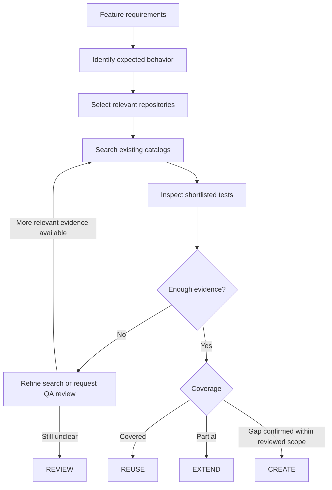

# 02 — Resolution Method

## Overview

The method has two parts:

- **Keep test information available:** index each automation repository, maintain the repository search scope and refresh Rally information.
- **Review each feature against existing tests:** understand the requirements, search the right repositories, verify candidates and decide what work is needed.

Indexing and search are deterministic. A model is used only where interpreting requirements or comparing behavior with test evidence requires reasoning.

## Keep test information available

### Maintain a catalog for each automation repository

Catalog indexing runs when changes reach the source repository's main branch. It identifies the tests that the framework can discover and records information that helps QA find them: test identity, source location, test level, tags, available assertion or API signals, and linked Rally TC references.

Each catalog is tied to the source commit it describes. A generated catalog is not a replacement for the test code or a claim that a business requirement is covered.

Framework discovery and static source analysis are used without LLM calls. Some test structures are difficult to resolve—particularly dynamic tests, shared fixtures and helper methods—so the catalog needs to show gaps in extraction. If framework discovery executes repository code, it must run in an isolated environment without production credentials.

### Keep repository scope explicit

A repository and business-flow map identifies which automation repositories belong to each service, frontend area and user journey. It includes shared E2E suites and the responsible teams.

This map gives QA a known search scope instead of relying only on a model to guess affected repositories. QA can add or remove repositories for a feature, but the final assessment records the scope that was actually searched.

### Refresh Rally information separately

The catalog records links to Rally TCs found in automation source. A separate, read-only Rally lookup checks those references and retrieves the last recorded result when available.

Rally information changes independently of source code, so a Rally refresh does not require rescanning the automation repository.

Keep these facts distinct:

| Fact | Meaning |
| --- | --- |
| Automation test present | The test definition exists at the catalog's source commit |
| Rally TC found | The linked record was accessible during the lookup |
| Rally TC unavailable | The record could not be resolved; deletion is not established |
| Rally deletion confirmed | There is separate, authoritative evidence of deletion |
| Last result recorded in Rally | A historical result with its own date and scope |
| Current execution result | Outcome of an actual CI/test run, if supplied by another system |

The meaning of "latest" must be agreed with Rally owners: project/workspace, relevant result type, environment and ordering rule. If the correct result cannot be determined, the lookup remains unresolved rather than selecting an arbitrary Pass or Fail.

Rally permissions may be narrower than GitHub repository permissions. Rally observations must not be published to a catalog readable by people who lack access to that data.

## Review a feature against existing tests

### 1. Understand the expected behavior

Read the feature specification, regardless of whether it comes from SpecKit or a custom SDD. Identify the conditions, actions and expected outcomes that QA must verify. Retain source references so QA can check the interpretation.

If a requirement is ambiguous, mark it for review. Do not invent a missing business rule.

### 2. Determine the affected test scope

Use the service and business-flow map, along with the feature impact, to select service-level, frontend and shared E2E repositories. Record the repositories that are included and any exclusions.

### 3. Search for existing tests

Search the selected catalogs using names, tags, Rally references, API/UI signals and domain terms. Rank candidate tests outside the model and return a short list with reasons for each match.

If results are weak, broaden the terms or include related repositories. Do not supply the whole catalog to the model.

### 4. Check what candidates actually verify

Inspect selected tests at their recorded source commits. Compare their setup, assertions, dependencies and testing level with the expected behavior. Include current execution evidence only when it is separately available and relevant.

The presence of a matching Rally record or a similar test title does not establish coverage.

### 5. Make a QA decision

| Decision | Meaning |
| --- | --- |
| **REUSE** | An existing test adequately checks the required behavior at the appropriate level |
| **EXTEND** | An existing test covers part of the behavior and can reasonably be expanded |
| **CREATE** | Reviewed evidence supports a remaining coverage gap in the relevant, sufficiently checked scope |
| **REVIEW** | Requirements, search scope, catalog freshness or test evidence are insufficient for a safe decision |

Tests at different layers are not automatically duplicates. An integration test and an E2E test can both be necessary.

### 6. Record the reasons

The QA plan identifies the requirement, repositories searched, catalog source commits, relevant tests, assertions reviewed and final recommendation. It also shows unknowns, Rally observations when authorized and any QA approval.

This makes the result useful to other teams and allows the same assessment to be checked later.

## Evaluator–Optimizer in this method

An evaluator checks whether the recommendation follows from the requirement and available test evidence. If not, the workflow can improve the search terms, inspect another candidate or revise the recommendation.

The loop stops when there is sufficient evidence, when further search adds nothing useful, or when its work limit is reached. Missing permissions, unclear requirements and unsupported test structures go to **REVIEW**; repeating a model prompt does not solve them.

The goal is a justified QA plan—not the largest possible set of generated tests.
