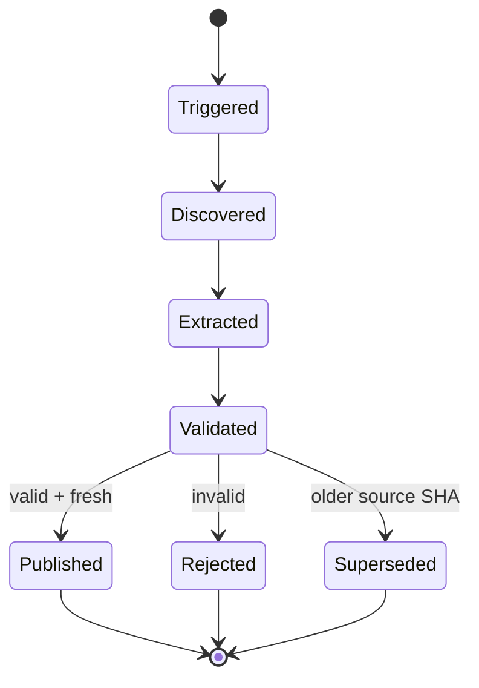

# 03 — Indexing Pipeline and Framework Adapters

## Trigger policy

**Recommended event:** GitHub Actions push on main (typically generated by PR merge). Direct pushes to main also trigger indexing if allowed. A scheduled reconciliation run and manual rerun are recommended for operational recovery.

The architecture assumes a repository has an available GitHub Actions runner. Enterprises without available runners can execute the same indexer specification through another CI platform; GHA is a trigger/runner, not a domain dependency.

## Pipeline stages

| Stage | Input | Required behavior | Failure policy |
| --- | --- | --- | --- |
| 0. Resolve job | Event, repo, source SHA | Capture exact triggering SHA, identity and config version | Fail on invalid source |
| 1. Checkout | Source SHA | Checkout immutable commit, not mutable main ref | Fail |
| 2. Install tools | Tool lock/config | Prepare framework runner and language analyzer | Fail |
| 3. Discover | Framework-specific projects | Enumerate suites, tests and execution variants | Fail if discovery incomplete |
| 4. Analyze | Test files, AST, optionally helpers | Extract annotations, calls, assertion signals, locations | Record per-field uncertainty |
| 5. Reconcile | Discovery output + AST output | Resolve identities and report unmapped cases | Fail or degrade under explicit policy |
| 6. Normalize | Reconciled input | Canonical JSONL sorted deterministically | Fail schema errors |
| 7. Validate | JSONL and manifest candidate | Check uniqueness, counts, references, provenance | Fail |
| 8. Freshness guard | Current main head, source SHA | Prevent publishing stale source as current | Rebuild/retry later |
| 9. Publish | Validated snapshot | Update qa-catalog branch and manifest as one Git commit | Preserve prior snapshot on failure |
| 10. Observe | Outcome + metrics | Record counts, duration, freshness, failure reason | Alert when stale |

**Important:** deterministic indexing does not imply perfect semantic understanding. If the framework can discover tests not mappable to source, record them with diagnostics; a catalog should never silently advertise full coverage when mapping is incomplete.

## Adapter design

### .NET: xUnit, NUnit, MSTest

- Prefer runner-supported discovery, e.g., test listing with the repository's actual test platform (VSTest or Microsoft.Testing.Platform). Commands and outputs vary.
- Roslyn extracts attributes such as Fact, Theory, Test, TestCase, TestMethod, and their local metadata when resolvable.
- Associate methods with fully qualified class/namespaces, source location, and discovered display names.
- For parameterized tests, distinguish a logical test definition from discovered case variants.
- Extract HTTP method/path and asserted status or expected values only when syntactically supported; helper calls are references, not confirmed behavior.

### JavaScript/TypeScript: Jest

- Respect the installed Jest version and test environments; file-listing is **not** equivalent to enumerating individual test cases.
- Use the project's supported test-collection/test-discovery facility where available.
- Use the TypeScript Compiler API or ts-morph-style syntax analysis for describe/test/it blocks, names, tags and assertion signatures.
- Dynamic names and runtime registration are reported as dynamic/unmapped if not reproducibly discovered.

### Playwright

- Prefer native test listing for configured Playwright projects.
- Parse test declarations, describe hierarchy, tags, annotations, and known expectation calls.
- Separate logical test definition from browser/project variants; a single TC may run in Chrome, Firefox and WebKit.
- Page-object methods, helper calls, and multi-service journeys require later inspection; they do not automatically prove business coverage.

### Cross-language future adapters

- Define consistent capability flags: discovers_cases, extracts_assertions, extracts_api_calls, resolves_helpers, and maps_execution_variants.
- Tree-sitter can be used for syntax-level extraction for further languages; semantic binding is language-specific.
- Unknown extraction fields are explicitly null/unknown and carry a reason.

## Rally link extraction

Every logical automation TC is expected to have a Rally TC link; include this as a deterministic extraction signal (e.g. test annotation, tag, attribute or controlled mapping). Record `rally_links[]`, the source of the link and a mapping status. If a mapping cannot be found, report a link-hygiene diagnostic instead of dropping the automation test. **Do not fetch Rally results inside framework discovery or AST parsing.** A separate Rally enrichment refresh handles existence and last stored result, even without a new code merge. See [Rally design](11-rally-enrichment.md).

## Parser strategy

Extract **observed signals**, not synthesized behavioral descriptions:

- Fully qualified symbol, file path and line range.
- Labels, tags, traits, owners when explicitly present.
- Assertion names and expected literal values where statically recoverable.
- HTTP method, path and client type where directly visible.
- Test setup calls, fixture identifiers, helper and page-object references.
- Static import dependencies and unresolved references.
- Original source span references (not the full test body).

Avoid inferring cross-service coverage simply from identifiers; a test that calls a payment helper may not assert payment behavior.

## Full snapshot first

Recommended phase-one strategy: regenerate a complete deterministic snapshot on each main update. This handles deletion/rename and avoids complicated incremental invalidation. Measure job duration and runner cost before adding optimization.

Future optimization can reuse unchanged file analysis keyed by: source content hash, relevant dependency fingerprints, configuration hash and extractor version. Shared helpers and runner configuration changes can invalidate many tests even when test files do not change.

## Snapshot validation

Minimum quality checks:

1. All configured discovery targets finished successfully.
2. Discovered count is reconciled with output records and unmapped diagnostics.
3. Stable IDs are unique within their chosen scope.
4. No duplicate execution variants under a logical identity.
5. Source pointers resolve within the checkout.
6. Serialized records validate against schema version.
7. JSONL is deterministically sorted and free of secret/test-data payloads.
8. Manifest hashes match catalog bytes and record count.
9. Source SHA matches indexing input and passes freshness guards.
10. No unexpected catastrophic count drop without explicit alert/review policy.

Count drops are not always errors (tests can legitimately be deleted). A configurable guard flags unexpected patterns without making a fixed count threshold a universal rule.

## Event-driven state machine

## Open implementation boundaries

This document specifies *what must happen*, not an implementation command or ready-to-run workflow. No .github/workflows YAML file is intentionally included.
