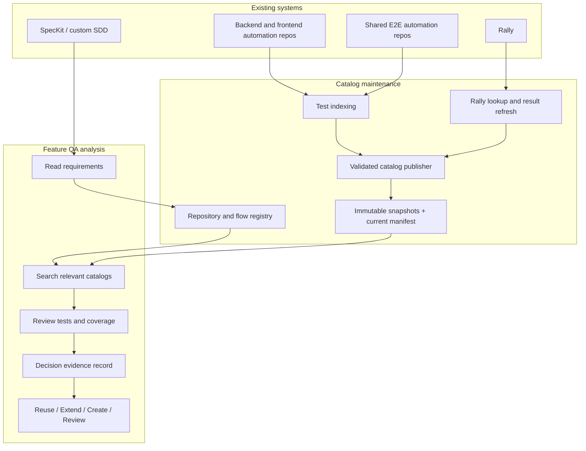
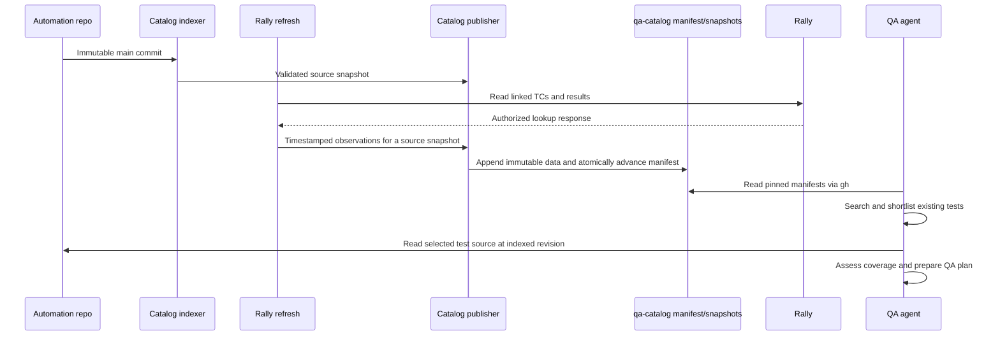

# 03 — System Architecture

## Overview

The design separates **catalog maintenance** from **QA analysis**, with an explicit repository registry and evidence record connecting them.

Catalog maintenance runs when source code changes or when Rally information needs to be refreshed. QA analysis runs when a team reviews a feature and needs to find existing tests. Keeping these activities separate avoids rescanning repositories or calling Rally for every QA request.

## Main components

### Automation repositories

Backend, frontend and shared E2E repositories continue to own their tests. The solution does not move tests into a common repository.

Each test catalog is tied to a specific source revision. This matters when test names, assertions or helper code change.

### Test indexing

The indexing process runs after changes reach a repository's `main` branch, using GitHub Actions where runners are available. It collects the tests that the framework can discover, together with information useful for searching them.

The indexer does not use an LLM. It cannot always resolve dynamic tests, helper logic or indirect service dependencies. Such gaps must be visible rather than presented as complete coverage.

The indexer has framework-specific adapters and two trust modes:

- **Static mode:** parses source and metadata without executing repository code.
- **Sandboxed discovery mode:** uses the framework's authoritative discovery only in an isolated, read-only, resource-limited job without production secrets or unrestricted egress.

Indexing runs from an immutable default-branch commit, not from an untrusted pull-request context with write credentials. It reconciles adapter output with framework discovery where supported and reports duplicates, parse failures, unsupported constructs and unmapped tests.

### Catalog storage

For the initial design, each automation repository publishes generated catalog information to a separate `qa-catalog` branch. This keeps generated changes out of feature PRs and the `main` branch history.

The catalog stores test information and references back to source. It is not a replacement for test code. Readers need to know the source revision and whether the catalog is up to date.

Source snapshots are immutable and addressed by source commit. Rally observations are immutable and identify the source snapshot and lookup time they apply to. A small manifest points to one compatible set. Publication validates counts, checksums, adapter versions and source ancestry before atomically advancing that pointer.

One publisher owns branch updates, or every writer uses compare-and-swap and retries after reconciling the new head. This prevents source-index and Rally-refresh jobs from losing each other's updates. Retention policy limits snapshot count, Rally history and Git branch growth.

### Repository and flow registry

The registry is an allowlist and routing map for catalog discovery. It maps services, frontend areas and business flows to repositories and owners. It also records catalog availability and supported framework adapters.

The registry has a named owner and review process. A feature analysis pins the registry revision it used. This makes cross-repository scope reproducible while still allowing QA to document manual additions or exclusions.

### Rally data refresh

Rally TC references come from automation metadata. A separate read-only lookup checks the linked records and reads the last result stored in Rally, if available.

This process does not depend on a code merge. A Rally record or result may change while the automation source stays unchanged.

The catalog reader must distinguish:
- A Rally TC that was found.
- A TC that could not be resolved, including permission-related cases.
- A TC whose deletion has been confirmed.
- A TC with no recorded result.
- A TC with competing results that the approved selection rule cannot resolve.
- A historical result that may be old.

The last recorded Rally result is not a current CI result.

The Rally adapter applies an approved result-selection rule covering record relationship, workspace/project, execution type or environment, ordering timestamp, timezone and ties. It records the selected result identity and time, or reports the result as ambiguous.

Rally lookup uses a read-only service identity, least-privilege project scope, secret rotation and rate-limit-aware retries. Authorization is evaluated before persisting observations. If Rally and GitHub audiences differ, Rally data is not written to the catalog branch.

### Catalog search

A local QA agent can use GitHub CLI (`gh`) to retrieve catalog files from the `qa-catalog` branch and cache them. It does not have to check out that branch into the working repository.

Search first uses test metadata and source references. Only relevant candidates are sent to the model for further analysis. If needed, the agent reads the test code at the source revision referenced by the catalog.

There is no requirement for an MCP server or a central search database in the initial design. A shared search service may become useful when the number of repositories, users or queries grows.

The client verifies manifest checksums and shows per-repository states: `CURRENT`, `STALE`, `PARTIAL`, `FAILED`, `UNAUTHORIZED` or `MISSING`. Cache entries are keyed by repository, manifest identity and source revision; stale data is never silently presented as current.

### Requirement analysis and QA decisions

Requirements from SpecKit or custom SDD documents are interpreted as testable scenarios with links to their original source. The workflow identifies the likely services and E2E journeys, searches their catalogs and checks candidate tests.

The final recommendation is to reuse an existing test, extend one, create a new one or request QA review. The evaluator can repeat the search with better terms when evidence is insufficient, but should not treat an empty search result as proof of a coverage gap.

### Evidence and audit

The decision evidence record pins every mutable input used for the recommendation. It records the requirement and registry versions, catalog manifests, source locations, Rally observation times, queries, ranking reasons and reviewer disposition. Logs and records must avoid source secrets, unrestricted test bodies and Rally fields not authorized for the audience.

## Data flow

The diagrams show the intended responsibilities, not a detailed CI or API sequence.

## System boundaries

**Access:** Repository permissions still apply. Rally data may have different access restrictions; only information permitted for the catalog's readers should be stored there.

**Trust:** Repository files and specifications are untrusted input. Discovery is isolated, retrieved content cannot issue agent instructions, and write credentials are confined to the publisher.

**Freshness:** Source indexing and Rally lookups have separate timestamps. If either is stale or unavailable, QA must see that limitation.

**Test results:** A Rally verdict reflects a result recorded in Rally. A current automation result must come from a separate CI or test execution source.

**Scope:** Searching only the service being changed may miss shared E2E coverage. The QA workflow needs a way to include relevant surrounding repositories.

**Scale:** Initial access through `gh` and local search avoids a new service. It also means each local client manages its cache; a shared index may be justified later.

**Availability and failure:** A failed update leaves the last valid manifest intact and reports degraded freshness. Partial snapshots are never published as current. Recovery is a retry or manifest rollback to an already validated immutable set.

**Consistency:** Source and Rally data have separate clocks but are joined through explicit snapshot identity. The manifest never points to files that were not validated together.

## Minimum logical catalog contract

This is a logical interoperability contract, not a physical JSON schema.

| Record | Required information |
| --- | --- |
| Manifest | Format version, repository ID, source snapshot ID, Rally observation ID if permitted, created times, checksums and publisher version |
| Source snapshot | Repository ID, source commit, default branch, adapter name/version, discovery status and counts |
| Test entry | Stable snapshot-local ID, framework node ID, file/line, parameterization, title/tags, extracted signals, Rally references and extraction warnings |
| Rally observation | Source snapshot ID, Rally reference, lookup status/time, selected result identity/verdict/recorded time and selection-rule version when authorized |
| Evidence record | Requirement and registry versions, searched manifests, queries, candidates, inspected source, decision, uncertainty and reviewer |

Test identity is exact within a source snapshot. Rename tracking across snapshots is best-effort and must not rely on title alone. Zero, duplicate or multiple Rally references are represented as data-quality findings rather than silently normalized.

## Operational signals

At minimum, emit indexing duration and failures, discovered/catalogued/excluded counts, manifest age, publication conflicts, Rally lookup outcomes and rate limits, search latency, candidate counts and decision-review outcomes. Alert on freshness breaches, failed publication, count regressions and authorization errors; do not alert merely because a valid Rally TC has no recorded result.
