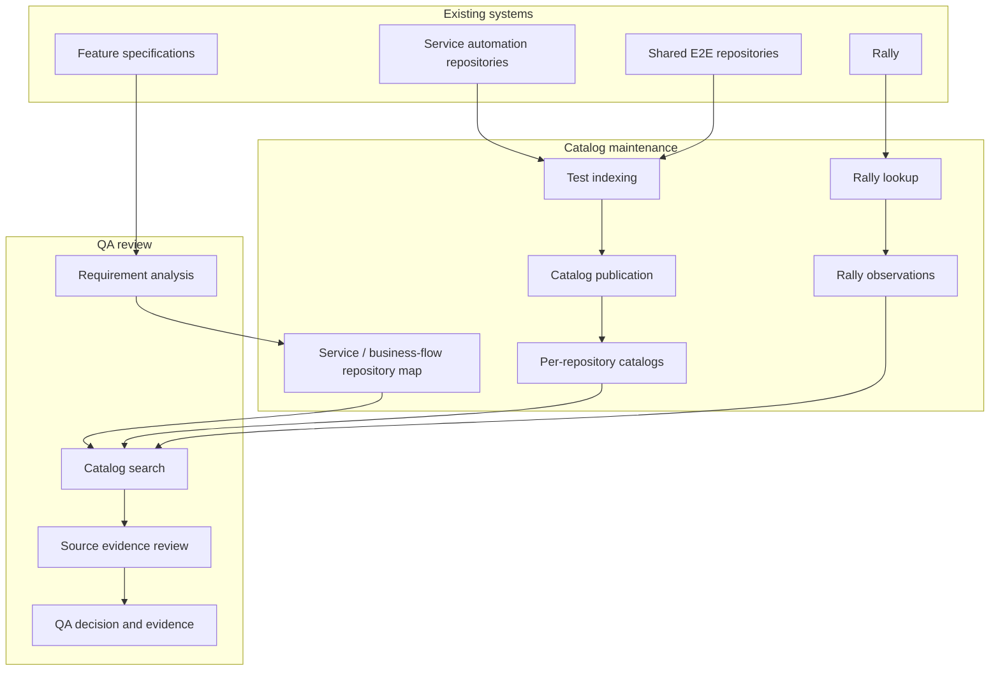
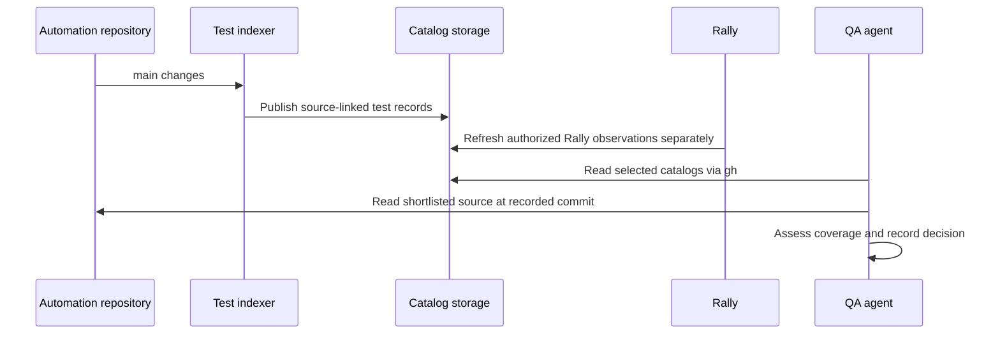

# 03 — System Architecture

## Overview

The system separates two kinds of work:

1. **Maintaining test information:** source indexing and Rally lookups keep the catalog searchable.
2. **Assessing a feature:** requirement analysis selects repositories, finds existing tests and reviews their actual coverage.

Keeping these activities separate means a QA request does not trigger a scan of every repository or a query for every Rally TC.

## Component responsibilities

### Automation repositories and test indexing

Automation repositories remain the source of truth for test code, fixtures and helpers. Indexing produces a catalog of tests that the supported frameworks can discover, along with searchable source-derived information.

Source indexing is triggered when an automation repository's `main` branch changes. GitHub Actions is the expected CI entry point where runners are available; another approved CI system can run the same indexing process.

The indexer runs without an LLM. It records unsupported or unrecognized tests instead of silently treating the catalog as complete.

Some framework discovery methods load test modules or run repository code. Such discovery must be isolated from production secrets, write access and unrestricted network connections. Static parsing is preferred where it provides sufficient information.

### Catalog storage and publication

Each automation repository holds its generated catalog on a separate `qa-catalog` branch. This avoids generated changes on `main` and keeps the catalog associated with its source repository.

The catalog identifies the source commit it describes. A reader can determine whether that catalog still matches the intended source code.

Publication must not replace newer information with an older job's output or combine incompatible source and Rally information. A validated current reference points to a consistent set of records. Failed updates leave the last valid catalog available and show that it may be stale.

This is a storage choice, not a requirement to check out the branch for searching.

### Service and business-flow map

A small, maintained registry maps services, frontend areas and business flows to their automation repositories, including shared E2E suites.

It is used to choose a search scope. It does not contain the tests themselves. Repository ownership and updates to the map must be clear, because missing repository mappings can make search results look complete when they are not.

### Rally lookup

The source index records Rally references associated with automation tests. A separate read-only lookup checks those records and reads historical result information when the requester is authorized to access it.

Rally lookup has its own refresh time, separate from the source catalog's commit. The stored result also has a recorded execution date that may be earlier than the lookup.

The system distinguishes found, unresolved, access-restricted and confirmed-deleted records. It also distinguishes a known result, no result and an ambiguous result selection. None of these states is a live CI result.

Rally observations can be associated with the catalog when the access policies permit it. Otherwise they remain in a store with appropriate Rally-level permissions or are retrieved during QA review.

### Catalog access and search

A QA agent can use GitHub CLI (`gh`) to read catalog files from the `qa-catalog` branch without checking it out. A local cache and search tool filter tests before returning candidate records to the model.

Search considers the selected repository scope, names, tags, source references, Rally IDs and available code signals. The agent fetches detailed source only for shortlisted tests and reads it at the commit recorded in the catalog.

`gh` provides access to GitHub content, not test ranking on its own. The search logic stays outside the model context. A dedicated MCP server is not required.

### QA evaluator and evidence record

The evaluator compares normalized requirements with selected tests and their source evidence. It can refine the search when the first candidates are insufficient, within a defined work budget.

The resulting QA plan links its decisions to requirements, searched repositories, catalog commits, inspected tests and relevant Rally observations. It records unresolved questions instead of hiding them behind a confident score.

## Independent update cycles

The Rally-to-catalog step above is conditional on Rally data being authorized for that catalog's readers. Otherwise Rally information stays in a separate controlled location.

## System constraints

| Area | Constraint |
| --- | --- |
| **Source accuracy** | Catalog entries must point to a specific repository and source commit |
| **Completeness** | Unsupported tests, failed discovery and excluded repositories must be visible |
| **Consistency** | Source and Rally observations must be matched to the correct test identity and kept separately dated |
| **Security** | Repository and Rally permissions cannot be bypassed by indexing, caching or model use |
| **Model context** | Catalog search and filtering happen outside the LLM; only limited evidence is passed in |
| **Availability** | A failed update does not erase the previous valid catalog, and stale data is clearly labeled |
| **Traceability** | A QA recommendation must show which evidence and repository scope it used |

The architecture describes the components and their responsibilities. It does not define framework parsers, CI workflow files, Rally API calls or a database schema.
