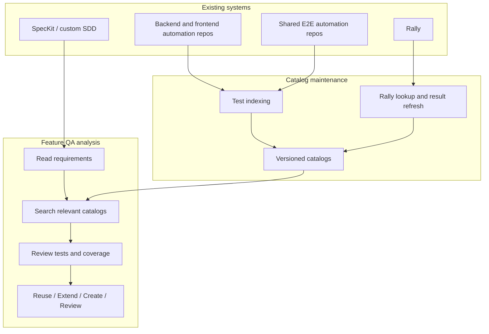
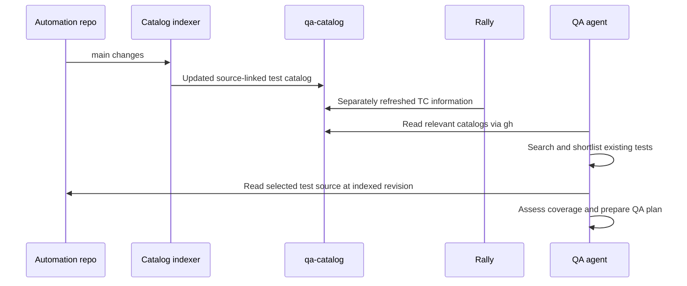

# 03 — System Architecture

## Overview

The design separates **catalog maintenance** from **QA analysis**.

Catalog maintenance runs when source code changes or when Rally information needs to be refreshed. QA analysis runs when a team reviews a feature and needs to find existing tests. Keeping these activities separate avoids rescanning repositories or calling Rally for every QA request.

## Main components

### Automation repositories

Backend, frontend and shared E2E repositories continue to own their tests. The solution does not move tests into a common repository.

Each test catalog is tied to a specific source revision. This matters when test names, assertions or helper code change.

### Test indexing

The indexing process runs after changes reach a repository's `main` branch, using GitHub Actions where runners are available. It collects the tests that the framework can discover, together with information useful for searching them.

The indexer does not use an LLM. It cannot always resolve dynamic tests, helper logic or indirect service dependencies. Such gaps must be visible rather than presented as complete coverage.

### Catalog storage

For the initial design, each automation repository publishes generated catalog information to a separate `qa-catalog` branch. This keeps generated changes out of feature PRs and the `main` branch history.

The catalog stores test information and references back to source. It is not a replacement for test code. Readers need to know the source revision and whether the catalog is up to date.

### Rally data refresh

Rally TC references come from automation metadata. A separate read-only lookup checks the linked records and reads the last result stored in Rally, if available.

This process does not depend on a code merge. A Rally record or result may change while the automation source stays unchanged.

The catalog reader must distinguish:
- A Rally TC that was found.
- A TC that could not be resolved, including permission-related cases.
- A TC whose deletion has been confirmed.
- A TC with no recorded result.
- A historical result that may be old.

The last recorded Rally result is not a current CI result.

### Catalog search

A local QA agent can use GitHub CLI (`gh`) to retrieve catalog files from the `qa-catalog` branch and cache them. It does not have to check out that branch into the working repository.

Search first uses test metadata and source references. Only relevant candidates are sent to the model for further analysis. If needed, the agent reads the test code at the source revision referenced by the catalog.

There is no requirement for an MCP server or a central search database in the initial design. A shared search service may become useful when the number of repositories, users or queries grows.

### Requirement analysis and QA decisions

Requirements from SpecKit or custom SDD documents are interpreted as testable scenarios with links to their original source. The workflow identifies the likely services and E2E journeys, searches their catalogs and checks candidate tests.

The final recommendation is to reuse an existing test, extend one, create a new one or request QA review. The evaluator can repeat the search with better terms when evidence is insufficient, but should not treat an empty search result as proof of a coverage gap.

## Data flow

The diagrams show the intended responsibilities, not a detailed CI or API sequence.

## System boundaries

**Access:** Repository permissions still apply. Rally data may have different access restrictions; only information permitted for the catalog's readers should be stored there.

**Freshness:** Source indexing and Rally lookups have separate timestamps. If either is stale or unavailable, QA must see that limitation.

**Test results:** A Rally verdict reflects a result recorded in Rally. A current automation result must come from a separate CI or test execution source.

**Scope:** Searching only the service being changed may miss shared E2E coverage. The QA workflow needs a way to include relevant surrounding repositories.

**Scale:** Initial access through `gh` and local search avoids a new service. It also means each local client manages its cache; a shared index may be justified later.
