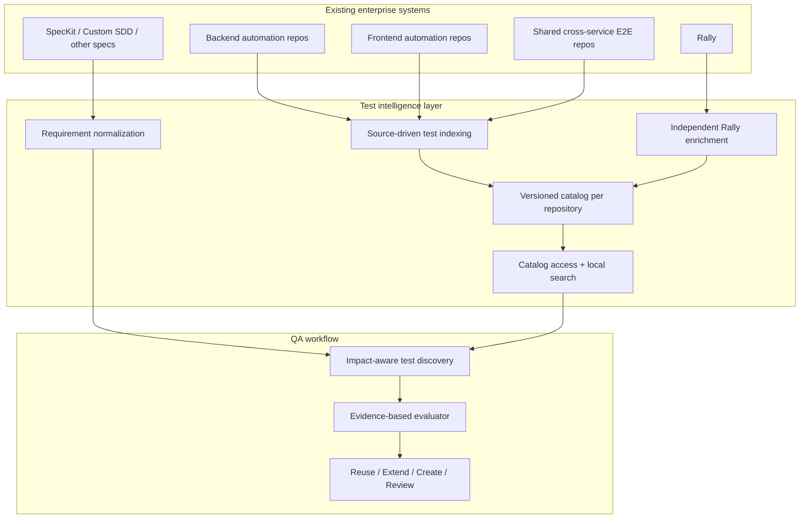
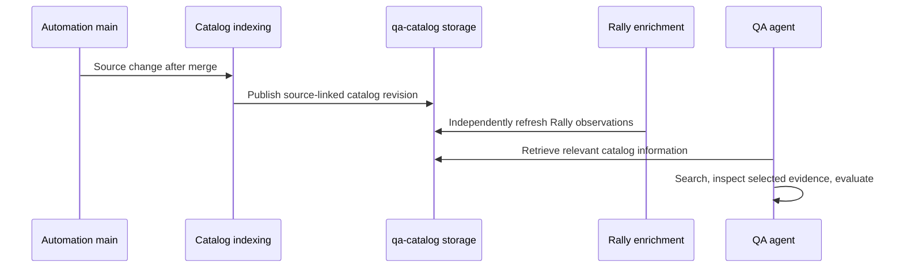

# 03 — Reference Solution Architecture

## Architecture overview

The proposed solution has **two independent information flows** feeding a **reuse-first QA decision flow**:

- **Source-driven flow:** automation repositories publish a lightweight catalog when source code changes.
- **Rally-driven flow:** Rally observations are refreshed separately when link validity or recorded result metadata may have changed.
- **QA consumption flow:** a coding agent uses compact catalog search results and only requests detailed source evidence for relevant cases.

## Logical building blocks

### 1. Source repositories and automation ownership

The source repositories remain the source of truth for tests, fixtures and automation behavior. Test definitions may cover a single service or an E2E journey that indirectly crosses several services.

**Architectural implication:** the system must search across appropriate repository scopes; a purely service-local view is insufficient.

### 2. Test catalog indexer

A repository-owned indexing process inventories framework-discoverable tests and extracts useful, **observed** signals such as identifiers, tags, source pointers and selected assertion or API-call hints. Indexing is deterministic and model-independent.

**Architectural implication:** indexing does not attempt to prove business coverage. When extraction is incomplete, the index advertises that limitation.

### 3. Versioned catalog storage

Catalogs are derived, versioned metadata associated with the exact source repository revision. The proposed initial storage model is a dedicated `qa-catalog` branch in each automation repository, separate from `main`.

**Architectural implication:** Git provides provenance without generated catalog changes entering feature history. A separate branch is **storage**, not a search engine.

### 4. Rally enrichment

Links to Rally TCs are captured from automation metadata. Independently refreshed Rally observations can identify accessible records, unresolved links and the **last result recorded in Rally**.

**Architectural implication:** Rally is a separate lifecycle. A new Rally result does not need a new source merge or source reindex. A source snapshot and Rally observation can have different freshness.

### 5. Catalog access and retrieval

For an initial deployment, a local QA agent can use **GitHub CLI (`gh`)** to retrieve catalog content from the designated branch, cache it, and perform deterministic lexical/metadata search before handing a concise shortlist to the LLM.

**Architectural implication:** neither MCP nor checkout of every catalog branch is required. An optional central search layer may later federate many repositories, subject to access controls.

### 6. Requirement interpretation

Feature specifications from different frameworks are mapped into a **canonical set of atomic, verifiable requirements**. Each obligation keeps a reference to the original source document.

**Architectural implication:** QA planning is independent of SpecKit/custom-SDD file templates, while preserving ambiguity and provenance.

### 7. Reuse-first coverage evaluation

The QA agent uses impact scope to find relevant tests, then examines only selected source and execution evidence. The evaluator decides whether obligations are already verified, partially verified, absent within a sufficiently inspected scope, or uncertain.

**Architectural implication:** reuse recommendations are evidence-backed, and CREATE is gated by coverage analysis rather than similarity alone.

## Two independent update lifecycles

This is a **logical sequence**, not a prescription for a specific CI implementation. The system must visibly distinguish the freshness of source metadata and Rally observations.

## Security and trust boundaries

- **GitHub repository authorization:** a user or agent must not retrieve metadata for repositories it cannot read.
- **Rally authorization:** Rally visibility may differ from GitHub visibility. Rally-derived fields must not be published to a broader audience without approval.
- **LLM context boundary:** catalog records and source comments are untrusted task data; tools should pass bounded information and not treat embedded instructions as commands.
- **Evidence boundary:** historical Rally results are not live CI health. Search results are not confirmed test coverage.

## Deployment evolution (conceptual)

**Initial solution:** per-repository catalogs + `gh` retrieval + local cache for a bounded group of repositories.

**Enterprise evolution, if needed:** federated search, richer cross-service relation data and optional semantic retrieval—introduced only after measuring retrieval quality and operating cost.

No specific database, language parser, workflow YAML, command sequence or schema is mandated in this architecture document.
