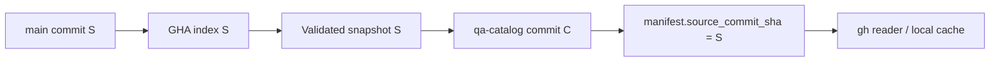

# 05 — Storage, Versioning and Publication

## Decision

Maintain a distinct branch named **qa-catalog** inside each automation repository. Its purpose is to hold *generated snapshot artifacts*, not production source. The default main branch remains free of auto-generated catalog commits.

## Recommended branch contents

| Path | Description |
| --- | --- |
| manifest.json | Identity, source revision, schema, completeness, integrity hashes |
| tests.jsonl | Canonical logical test records |
| diagnostics.json | Unmapped tests, unsupported patterns, warnings, change statistics |
| README.md | Minimal generated branch explanation |

Avoid storing raw source copies or full execution reports in this branch.

## Why not commit into main?

- Generates noisy history and possible conflicts for feature developers.
- May violate required PR reviews and protected-branch policies.
- A catalog commit created with GITHUB_TOKEN may not trigger follow-on push workflows.
- Data is derived and can be regenerated from source; it is not source of truth.

## Consistency invariant

A catalog snapshot is **current** only if its manifest source_commit_sha matches the latest main revision *for the intended query scope*. Otherwise it is stale, even if it is the latest qa-catalog branch commit.

Do not merge a qa-catalog branch into main. Treat it as a separate publication stream.

## Publication algorithm (conceptual)

1. Index immutable source commit S.
2. Validate catalog bytes and manifest locally.
3. Read current main head H before publish.
4. If H != S, mark candidate as superseded. Schedule/allow indexing of H.
5. Read current qa-catalog head C with optimistic concurrency.
6. Write all output files and manifest together as one Git tree/commit.
7. Update qa-catalog ref without force. If concurrent publication wins, reload head and compare source commit.
8. Recheck main head after publication if strong freshness assurance is required; if main advanced, report catalog as temporarily stale.
9. Expose successful publication and freshness lag in monitoring.

**Important concurrency nuance:** GitHub Actions concurrency groups reduce overlapping work, but cannot alone guarantee publication ordering. The publisher needs an explicit source freshness check and guarded branch ref update.

If branch protection forbids automated writes, use a narrowly scoped GitHub App token or an approved exception. Do not disable protection solely for catalog publication.

## First-time initialization

The qa-catalog branch can begin with a generated initial snapshot and minimal README. The branch need not share file history with main, although creating it from main is possible; keeping history unrelated avoids duplicating source tree in catalog branch. This is an implementation-time choice.

## Failure behavior

- Extraction error: **no new snapshot**; previous snapshot remains readable but may be stale.
- Schema/validation error: no publish; report failed completeness.
- Concurrent write: retry with latest branch ref after verifying source freshness.
- Older run finishing late: must not supersede the catalog for newer main.
- GitHub API rate limit: backoff/retry through CI; avoid model involvement.
- Unauthorized actor: fail publishing without elevating broad permissions.

## Retention

- Git branch history persists until altered by retention/administrative policy.
- Full snapshots may increase repository pack size over time; monitor catalog size and update frequency.
- Avoid force-pushing qa-catalog by default. Define a retention/migration strategy if storage growth becomes material.
- GitHub Actions artifact uploads are diagnostic convenience, not canonical long-term storage.

## Consumer behavior under staleness

A reader compares manifest.source_commit_sha against the required source SHA and displays one of CURRENT, STALE, INCOMPLETE, or UNAVAILABLE. High-risk coverage decisions should not treat stale or incomplete catalog content as exhaustive.

An agent can still inspect a pinned historical snapshot if the feature explicitly targets that revision.
