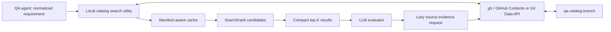

# 06 — Runtime Retrieval via GitHub CLI

## Decision

Use a local deterministic **catalog reader/search utility** that employs GitHub CLI (gh) as transport. Do not require an MCP server. The agent uses a small set of conceptual operations: sync, search, inspect, and status.

This document specifies behavior and interfaces; it does **not** contain executable CLI implementation.

## Architecture

## Required gh transport behavior

- Authenticate using gh on GitHub.com or configured GitHub Enterprise host.
- Read manifest.json and tests.jsonl at **ref qa-catalog** through the GitHub API; no checkout or clone is necessary.
- For source inspection, request individual test files or blobs at the **pinned source commit SHA**, not current main.
- Keep raw JSONL on local filesystem or parse it inside the search utility. Do not paste its contents into the LLM context.
- Detect rate limits, missing repositories and permission failures explicitly.
- Never send private repo catalog data to unrelated users or search tenants.

GitHub Code Search should not be the sole query mechanism for a catalog stored outside the default branch. Fetching catalog files by a specific ref and indexing them locally avoids that limitation.

## Logical CLI surface (design only)

| Operation | Input | Output |
| --- | --- | --- |
| sync | repo(s), host, branch, freshness mode | Local snapshot/cache status |
| search | normalized behavior, filters, limit | Shortlisted compact test records |
| inspect | test ID, source SHA, detail level | Evidence with source ranges |
| related | API/service/fixture keys | Related candidate IDs |
| status | repo | CURRENT, STALE, INCOMPLETE, UNAVAILABLE |

No command implementation is included. A future CLI can expose commands with these names or provide equivalent library operations.

## Manifest-aware caching

1. Retrieve small manifests for relevant repositories.
2. Compare content hash/source SHA with cached snapshot.
3. Download JSONL only when changed.
4. Build or refresh an indexed local representation (e.g., SQLite FTS5).
5. Query using lexical/BM25 metadata filters first.
6. Return compact records containing IDs, reasons and source pointers.
7. Load detailed code only for a small subset requiring verification.

Repository scope must be chosen from feature ownership, code-impact signals, service dependencies, and relevant shared E2E repositories. An empty initial result should expand to related repositories before declaring coverage absent.

## Rally metadata lookup

The gh-based reader may retrieve `rally-manifest.json` and `rally-enrichment.jsonl` and perform a deterministic local join to the current `tests.jsonl` using canonical Rally references. Verify that source catalog revisions match and freshness is acceptable. Search can filter by Rally TC ID, link-resolution state or historical result. Display Rally LastVerdict/LastResult only as **last recorded Rally outcome with date/source**, never as current CI/runtime automation result. A missing/inaccessible Rally TC must not cause the search utility to exclude the automation test or infer that no existing test is available. See [Rally enrichment](11-rally-enrichment.md).

## Retrieval stages and safeguards

| Stage | Method | LLM context |
| --- | --- | --- |
| 1 | Repository selection and availability checks | Counts/status only |
| 2 | Exact IDs, tags, API operations and metadata filters | None |
| 3 | Local full-text/BM25 lexical retrieval | None |
| 4 | Optional candidate reranking and graph expansion | Compact top-K |
| 5 | Lazy source and assertion/fixture inspection | Bounded excerpts |
| 6 | Coverage evaluation per atomic obligation | Only referenced evidence |

An optional vector index can be introduced if measured Recall@K is insufficient; it is not a required part of phase one.

## Query budgeting and stopping criteria

- Suggested start: retrieve up to 50–100 candidates outside the LLM; only 10–20 summaries enter a model call.
- Drill down into 3–5 tests when the evaluator requests more evidence.
- Cap retrieval expansion passes (e.g., three, configurable).
- Use no-result, low-confidence, or missing-repository cases as **REVIEW/UNKNOWN**, not automatic permission to create new tests.
- Preserve retrieval diagnostics: which repositories/branches/filters were searched, index versions, and query coverage.

These numbers are **PoC defaults for benchmarking**, not validated universal thresholds.

## Search response shape

See [synthetic search result](../mock-data/search-results.json). It includes query scope, catalog freshness, candidate IDs, match signals and the fact that matches are **not** coverage verdicts.

## Multi-repository scale-up

The reader can cache each repository independently. A future central index can replace the local cache without changing the data contract or evaluator semantics. Any shared index must enforce source repository authorization at query time.
