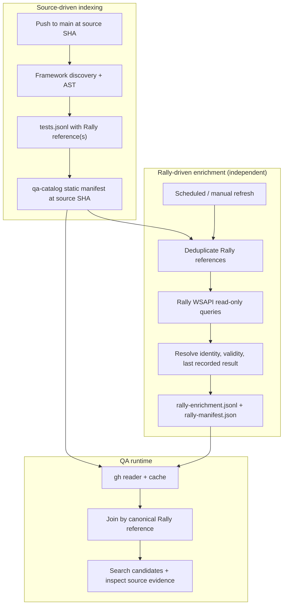

# 11 — Rally Test Case Link and Last Recorded Result Enrichment

**Status:** Proposed. **Scope:** Enrich a deterministic automation catalog with *Rally-managed metadata*, without changing how automation tests are discovered.

## Context and vocabulary

Every automation TC in the target estate is expected to link to one Rally Test Case. Some linked Rally Test Cases may have been deleted, moved, or made inaccessible; an existing Rally Test Case may contain a last recorded test result. This is a *historical Rally record*, **not** the outcome of the automation test currently running in CI.

Keep these three dimensions separate:

| Dimension | Definition | Never infer |
| --- | --- | --- |
| Automation existence | Does this test definition exist at the indexed repository SHA? | Whether its linked Rally case exists |
| Rally linkage/validity | Can we resolve the linked Rally Test Case, in the intended workspace/project context? | Whether the automation test is correct, obsolete, or should be deleted |
| Rally recorded result | What result/verdict was most recently recorded in Rally, with timestamp and provenance? | Current CI/runtime pass/fail, flakiness, or live health |

**Primary rule:** A Rally status/value is supporting metadata for search, triage, and traceability. It is **not** proof of behavioral coverage and must not override source-level evidence or current CI results.

## Architecture: two independent clocks

The GHA source scan should **extract Rally references without requiring Rally API availability**. An enrichment job can run after a new static catalog, on a schedule, or on demand. Each refresh reads Rally only for distinct referenced cases; it does not rescan automation code.

## Source linkage model

Record these fields (per logical automation TC):

- `rally_links[]`: explicit references found in test annotations, tags, attributes, mappings or configured conventions.
- `formatted_id`: human-facing ID such as `TC12345`, when available.
- `object_id`: Rally ObjectID (more stable for API lookup), when already known.
- `workspace_id` and optional `project_id`: distinguish scopes; Rally identifiers must not be assumed globally unique across all Rally instances.
- `instance`: configured Rally environment alias, never a secret or token.
- `link_source`: where the mapping was extracted (file/span or mapping file).
- `mapping_status`: `LINKED`, `MISSING_REFERENCE`, `AMBIGUOUS`, or `UNPARSEABLE`.

Treat link cardinality explicitly: many automation tests may refer to the same Rally TC; one automation test may refer to more than one TC. Confirm whether the target organization enforces exactly one Rally TC per logical test. A mapping error is a catalog diagnostic and must not make the automation test disappear.

## Rally identity and existence status

Status vocabulary for the enrichment overlay:

| State | Meaning | Required handling |
| --- | --- | --- |
| `FOUND` | A matching Rally Test Case was resolved under the authorized context | Record ObjectID, formatted ID, workspace, fetched_at |
| `NOT_FOUND_UNCONFIRMED` | Lookup returned no accessible matching case | Do **not** automatically call this deleted |
| `DELETED_CONFIRMED` | Deletion independently verified by an authorized source (e.g., admin-supported recycle-bin investigation) | Surface a broken link for QA triage, do not delete code |
| `ACCESS_DENIED` | The token cannot read an item or workspace | Mark inaccessible, do not infer existence |
| `AMBIGUOUS` | Multiple candidates or conflicting identifiers | Review identity mapping |
| `LOOKUP_ERROR` | API failure, timeout, or throttling | Keep last-known observation and mark stale/error |
| `UNKNOWN` | Not queried yet / insufficient context | No existence conclusion |

Broadcom notes that missing artifacts may result from deletion **or permissions/project scope**, and recommends workspace search and recycle-bin checks. Therefore a 404, zero-result query, or invisible item is **not enough** for `DELETED_CONFIRMED`.

Reference: https://knowledge.broadcom.com/external/article/47891

## Rally's last recorded test result

Prefer an explicit last-result object, when available and authorized, recording its own provenance. The Rally WSAPI TestCase includes last-result/last-verdict related fields; TestCaseResult records include fields such as `Verdict` and `Date`. Confirm the exact field names supported by the organization's WSAPI object model and any custom fields before implementation.

Do **not** interpret `LastVerdict` as a current automation verdict. If the source is a TestCase aggregate, record the source field (e.g., `TestCase.LastVerdict`) rather than silently labeling it an independently fetched TestCaseResult. If a result record is fetched, sort by the chosen execution/result date within the proper workspace, test case and optional test-set scope; record the sorting rule. A later update timestamp is not necessarily a later executed test. A stored result might be manual or automated; never assume its origin without evidence.

Proposed fields:

| Field | Meaning |
| --- | --- |
| `last_recorded_result.verdict` | Rally verdict: Pass/Fail/Blocked/Inconclusive or value supported by tenant; nullable |
| `last_recorded_result.executed_at` | Date of the recorded result, nullable |
| `last_recorded_result.result_object_id` | Exact TestCaseResult ObjectID if fetched; nullable for aggregate fields |
| `last_recorded_result.source_field` | e.g., `TestCaseResult.Verdict` or `TestCase.LastVerdict` |
| `last_recorded_result.recorded_origin` | `AUTOMATION`, `MANUAL`, or `UNKNOWN`; default UNKNOWN |
| `last_recorded_result.test_set_id` | Optional scope identifier, if relevant |
| `last_recorded_result.build` | Optional non-secret build reference |
| `last_recorded_result.fetched_at` | When metadata was observed in Rally |
| `last_recorded_result.freshness` | `FRESH`, `STALE`, `UNKNOWN` relative to query policy |

`verdict = null` means **no recorded result was found within the authorized searched scope**, or results could not be resolved; distinguish `NO_RESULT` from `NOT_QUERIED` and `LOOKUP_FAILED`.

Reference: https://knowledge.broadcom.com/external/article/131935/rally-wsapi-collection-summaries.html  
WSAPI object-model lookup: https://knowledge.broadcom.com/external/article/99961/how-to-find-all-available-wsapi-fields-o.html

## Separate snapshot contract and freshness

Keep the deterministic static snapshot from main:

- `manifest.json` + `tests.jsonl`, tied to immutable `source_commit_sha`.

Add independently refreshed overlays to **the same qa-catalog branch**:

- `rally-manifest.json` + `rally-enrichment.jsonl`, tied to `source_catalog_revision`, `rally_fetched_at`, `rally_workspace_scope`, and overlay hash.

Both overlays should be published atomically *with their own manifest*, not require reindexing source tests. The static and Rally artifacts can have different observation timestamps and update cadences; a Rally refresh should **not** advance the static `source_commit_sha`.

When the static snapshot changes, preserve the old overlay for audit if necessary but mark it **MAPPING_STALE** until the new mapping revision is reconciled. A reader must not silently join mismatched versions.

## Sync policy and scaling

- Source indexing: after main advances.
- Rally enrichment: after validated static catalog publication, plus scheduled/manual refresh to catch result updates and deleted/recovered artifacts without code merges.
- Resolve distinct Rally case references **once per refresh**, not once per automation test. Cache by instance/workspace/ObjectID; batch queries where feasible and obey WSAPI paging/rate limits.
- Keep both successful and failed lookup observations with timestamps; retry transient errors with bounded backoff.
- For a single repo with 1,000+ TCs, do **not** send Rally responses or all catalog records to the LLM. All enrichment is deterministic and should use **zero LLM tokens**.
- Cache results per Rally reference, respecting different freshness windows for existence and last-result metadata.
- Optional optimization: Rally WSAPI TestCase.LastUpdateDate can help select changed cases, followed by fetching their related results. Broadcom reports that TestCaseResult and TestCaseStep do not expose the same last-update field and that updates to them changed the parent TestCase.LastUpdateDate in their testing. Verify tenant behavior and supplement with periodic full reconciliation, since deleted cases may not appear in changed-record queries. Reference: https://knowledge.broadcom.com/external/article/194333/rally-how-to-get-last-update-date-for-te.html
- Rally API token belongs in an approved CI secret store, scoped read-only and never committed to any catalog branch.
- Read access to Rally information may be more restrictive than GitHub repo access. The producer/consumer must check whether enrichment is allowed to be published to everyone who can read that repo. Where permissions differ, store only permitted fields or move enrichment to controlled storage.

## Query-time usage

Search by Rally TC `FormattedID`, ObjectID, owner/project when authorized, plus normal source signals. Return compact fields:

1. Automation test identifier and pinned source location.
2. Rally link and resolution state.
3. Historical Rally verdict/date/fetched-at with explicit "not runtime" meaning.
4. Data-freshness warnings, including unmatched mappings or inaccessible Rally scope.
5. Evidence fetch option for assertion-level coverage evaluation.

Rally `DELETED_CONFIRMED` should raise an **orphaned mapping** issue; Rally `LastVerdict = Fail` should raise a **historical signal**. Neither automatically instructs the agent to remove/rewrite the automation test or create a new TC.

## Acceptance tests

| ID | Scenario | Expected outcome |
| --- | --- | --- |
| R-01 | Linked Rally TC found, latest result Pass | FOUND + historical Pass with source/date |
| R-02 | Rally TC found, no results | FOUND + NO_RESULT, no runtime verdict |
| R-03 | Lookup returns 404 but access unclear | NOT_FOUND_UNCONFIRMED, not DELETED_CONFIRMED |
| R-04 | Authorized deletion proof exists | DELETED_CONFIRMED, orphan mapping flagged |
| R-05 | Rally access denied | ACCESS_DENIED, no false deletion |
| R-06 | Multiple tests point to same Rally ID | Deduplicate API lookup, retain all mappings |
| R-07 | Rally result changes without a code merge | Overlay refreshed, static catalog unchanged |
| R-08 | main advances during Rally refresh | Versioned overlay mismatch marked MAPPING_STALE |
| R-09 | Rally API down | Retain old data as stale, do not fail static indexing |
| R-10 | Rally last verdict Fail, current CI passed | Both states displayed separately, no contradiction inferred |
| R-11 | Rally results filtered to wrong project/test set | Scope mismatch flagged; no misleading 'latest' |
| R-12 | Invalid/missing Rally reference | Diagnostic for link hygiene; automation TC remains searchable |

## Deferred decisions

- Rally link annotation conventions per framework.
- Tenant-specific WSAPI field definitions and allowed API key scope.
- Whether the organization defines "valid" by existence alone or by Rally lifecycle state/custom field.
- Whether last result is scoped globally, by test set, or by configured environment.
- Refresh schedule/TTL based on user expectations and Rally API limits.
- Access policy for publishing Rally metadata onto a Git branch shared with code readers.
